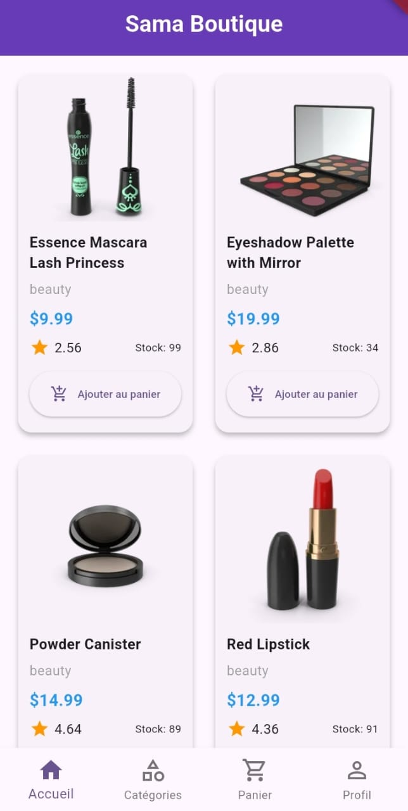
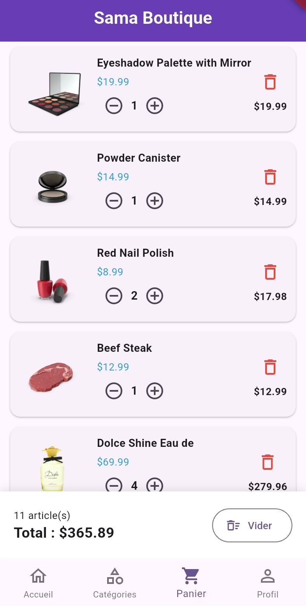

# Sama Boutique

Application mobile de boutique en ligne développée avec **Flutter** dans le cadre d'un TP.
Les produits sont récupérés depuis une API publique, et l'utilisateur peut consulter le détail d'un produit et gérer son panier.

## Fonctionnalités

- **Accueil** : liste des produits en grille (image, titre, catégorie, prix, note, stock)
  - indicateur de chargement
  - message d'erreur avec bouton « Réessayer »
  - tirer vers le bas pour actualiser (pull to refresh)
- **Détail d'un produit** : un clic sur une carte ouvre la page `DetailProduct` (image, titre, catégorie, prix, note, stock, description)
- **Panier**
  - bouton « Ajouter au panier » sur chaque carte produit
  - ajout d'un produit déjà présent : sa quantité augmente
  - modification de la quantité (+ / −), limitée au stock disponible
  - suppression d'un produit, ou vidage complet du panier
  - affichage du nombre d'articles et du total
- **Navigation** par barre du bas : Accueil, Catégories, Panier, Profil

> Les onglets **Catégories** et **Profil** sont des pages provisoires, prévues pour les prochaines étapes du TP.

## Technologies

| Outil | Usage |
|-------|-------|
| Flutter / Dart | Développement de l'application |
| [`http`](https://pub.dev/packages/http) | Requêtes vers l'API |
| `ChangeNotifier` + `AnimatedBuilder` | Gestion d'état (sans package externe) |
| [DummyJSON](https://dummyjson.com/products) | API publique de produits (aucune clé requise) |

## Architecture

Le projet est organisé en couches, selon une logique MVC :

```
lib/
├── main.dart                     # Point d'entrée de l'application
├── main_navigation.dart          # Barre de navigation (4 onglets)
├── models/
│   ├── product.dart              # Modèle Product (conversion JSON → objet)
│   └── cart_item.dart            # Ligne du panier (produit + quantité)
├── controllers/
│   ├── product_controller.dart   # Récupération des produits via l'API
│   └── cart_controller.dart      # Logique du panier (instance unique partagée)
├── views/
│   ├── product_view.dart         # Page d'accueil (liste des produits)
│   ├── detail_product.dart       # Page de détail d'un produit
│   ├── cart_view.dart            # Page du panier
│   ├── category_view.dart        # Page Catégories (provisoire)
│   └── profile_view.dart         # Page Profil (provisoire)
└── widgets/
    ├── product_card.dart         # Carte d'un produit
    └── cart_item_tile.dart       # Ligne d'un produit dans le panier
```

Le panier (`CartController`) est une instance unique partagée : `ProductCard` y ajoute des produits et `CartView` s'actualise automatiquement à chaque modification.

## Installation et lancement

### Prérequis

- [Flutter SDK](https://docs.flutter.dev/get-started/install) (version compatible avec le SDK Dart indiqué dans `pubspec.yaml`)
- Un émulateur Android / iOS ou un téléphone connecté
- Une connexion Internet (pour charger les produits)

### Étapes

```bash
# 1. Cloner le dépôt
git clone https://github.com/CoumbaaDiouf/sama_boutique
cd sama_boutique

# 2. Installer les dépendances
flutter pub get

# 3. Lancer l'application
flutter run
```

## API utilisée

Les données proviennent de l'API publique [DummyJSON](https://dummyjson.com/) :

```
GET https://dummyjson.com/products
```

## Captures d'écran





## Limites actuelles et pistes d'amélioration

- Le panier est conservé en mémoire uniquement : il est vidé à la fermeture de l'application
- Pages Catégories et Profil à développer
- Pistes : badge du nombre d'articles sur l'icône du panier, bouton « Ajouter au panier » sur la page de détail, filtrage par catégorie, sauvegarde locale du panier

## Auteur

Projet réalisé par **Coumba Diouf** dans le cadre d'un TP Flutter.
